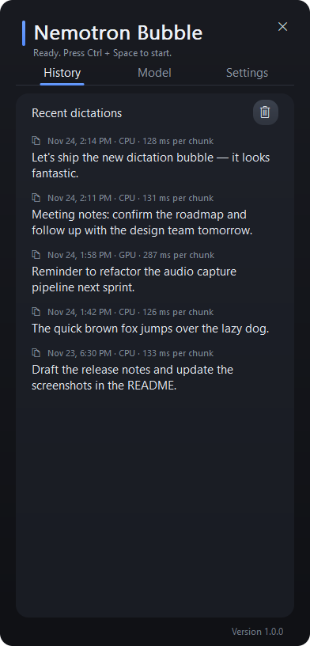
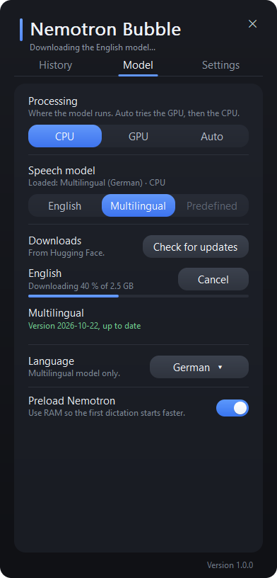
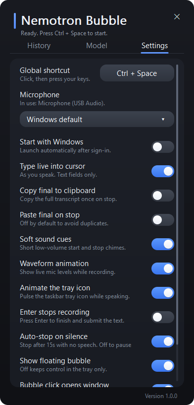

# Nemotron Bubble

**A tiny, beautiful push-to-talk dictation bubble for Windows.**

Press shortcut, speak, and your words appear at the cursor. Speech recognition runs **on-device** with NVIDIA Nemotron.


   

___

## Features

<details>
<summary>Show all features</summary>

| Feature | Description |
| --- | --- |
| **Push-to-talk** | One shortcut starts and stops dictation from any app. |
| **Customizable shortcut** | Click *Global shortcut* on the *Settings* tab and press any combo (Ctrl / Alt / Shift + key). The default is `Ctrl+Space`. |
| **Types as you speak** | The words appear at the cursor while you speak. The clipboard stays untouched. |
| **Auto-stops on silence** | A forgotten recording does not run forever. It stops after 15 s of quiet. |
| **Private and offline** | The Nemotron ONNX model runs locally. No internet, no accounts, no telemetry. |
| **English or multilingual** | Pick the model. For the multilingual one, pick the spoken language or let the model detect it. |
| **CPU or GPU** | Run the model on the processor or on any DirectX 12 graphics adapter. |
| **Live waveform bubble** | A smooth, anti-aliased floating mic meter in one of six preset screen positions. It can also be dragged anywhere. |
| **Tray mode** | Hide the bubble and watch the waveform pulse right in the taskbar tray instead. |
| **Recent dictations** | A scrollable history. The icon next to each entry copies it, and each entry shows how fast it was processed. |
| **Copy or paste on stop** | For apps where keystrokes trigger shortcuts, turn off live typing and let the transcript be copied to the clipboard or pasted once when the dictation stops. |
| **Portable** | Settings, history and logs live next to the exe. |
| **Everything toggleable** | Start with Windows, soft sound cues, model preloading and more. |

</details>

___

## What's new in this fork

This is a fork of [snipemanmike/nemotron-bubble](https://github.com/snipemanmike/nemotron-bubble). It keeps the original idea of a tiny, private dictation bubble and builds on it with the following changes:

<details>
<summary>Show all changes</summary>

| Change | Description |
| --- | --- |
| **Redesigned application window** | A compact window with three tabs (*History*, *Model*, *Settings*) that opens right next to the bubble or the tray icon. Each history entry has a copy icon and shows how fast it was processed. |
| **Multilingual model fixed** | The multilingual Nemotron model crashed while loading and left the app without speech recognition. It now loads reliably and can be selected next to the English model. |
| **Bubble position presets** | Place the floating bubble in one of six positions (top or bottom, each left, center or right). The choice is saved. |
| **Microphone selection** | Choose the input device in the app instead of in the Windows settings. *Windows default* follows a change of the Windows default device without restarting the app. |
| **Model downloads in the app** | Download, resume and update both models on the *Model* tab instead of with a PowerShell script. Every file is verified with SHA-256, and the date of the model version is shown. |
| **GPU support** | Run the model on the GPU via DirectML, which works with any DirectX 12 graphics adapter, or stay on the CPU. *Auto* tries the GPU first. |
| **Language selection** | Tell the multilingual model which language you speak instead of letting it guess. 15 languages are offered, and NVIDIA rates this as more accurate than auto-detection. |
| **Microphone status at a glance** | Without a microphone the app keeps running instead of quitting. The bubble shows an amber dot and a crossed-out microphone, the tray icon is crossed out, and both tell the reason on hover. A microphone that is connected later is picked up automatically. |
| **Close from the bubble** | A ✕ appears on the bubble's top-right edge while the mouse is over it and quits the app, so the tray menu is no longer the only way out. |
| **Clear error feedback** | A model that fails to load shows a message instead of the app silently quitting. A log file and `--self-test` help to find the cause. |
| **Portable** | Settings, history and logs are stored next to the exe instead of in `%APPDATA%`. |
| **App icon and version** | The exe has its own icon, and the version is shown in the application window, the tray menu and the file properties. |

</details>

___

## Requirements

- **Windows 10 or 11** (64-bit).
- A **microphone**.
- **About 2.5 GB free disk** per speech model (downloaded once, from the app).
- **~3 GB of free RAM** while dictating, because the model runs entirely in memory.

> [!NOTE]
>
> The Nemotron model has ~0.6B parameters and uses roughly **2.5 to 3 GB of RAM** while loaded. With *Preload Nemotron* enabled (default) that memory is held so the first dictation is instant. Turn it off to keep RAM free when idle. The model then loads on first use instead.

___

## Quick start

Download a prebuilt binary from the [Releases](https://github.com/LittleGitPhoenix/nemotron-bubble/releases) page and extract it into a folder of your choice.

On the first start no speech model is installed yet. Open the application window, go to the *Model* tab and click **Download** next to either **_English_** or **_Multilingual_** (about 2.5 GB each). The app downloads the files from Hugging Face into `models\` next to the exe, verifies them and loads the model.

___


## The application window

The main interface consists of three tabs to keep it compact. Click the bubble or the tray icon to open it. It appears next to whatever you clicked. The line under the title shows the latest status message, for example *Listening...* or why a click had no effect.

> [!NOTE]
>
> The ✕ at the top right hides the window again and the app keeps running in the tray. Speech model, language and processing are also in the tray icon's right-click menu.

<table>
  <tr>
    <th width="33%"><a href="#history">History</a></th>
    <th width="33%"><a href="#model">Model</a></th>
    <th width="33%"><a href="#settings">Settings</a></th>
  </tr>
  <tr>
    <td></td>
    <td></td>
    <td></td>
  </tr>
</table>


### History

Recent dictations, newest first. The icon in front of each entry copies its text to the clipboard. The grey line above the text shows when it was dictated, on which device (CPU or GPU) it was processed, and the processing time per audio chunk. The list scrolls with the mouse wheel. The trash bin clears the whole history.


### Model

In this tab **Nemotron** speech model download and configuration can be managed.

#### Processing (GPU or CPU)

Under **Processing** (also in the tray menu) choose where the model runs:

| Choice | Runs on |
| --- | --- |
| **CPU** (default) | the processor |
| **GPU** | DirectML, which works with any DirectX 12 graphics adapter including integrated ones |
| **Auto** | the GPU if possible, otherwise the CPU |

Switching reloads the model. The line under *Speech model* shows the device in use. Each entry on the *History* tab shows the device and the processing time, so you can compare both on your machine. An integrated GPU is not necessarily faster than the CPU.

#### Speech model

Pick the model under **Speech model** (also in the tray menu):

| Choice | Loads |
| --- | --- |
| **English** | the English model |
| **Multilingual** | the multilingual model, which detects the spoken language automatically |
| **Predefined** | a model folder of your own (see [README_Technical.md](README_Technical.md#model-location)) |

The line under *Speech model* shows what is loaded, as reported by the model itself.

#### Downloads and updates

| Element | Meaning |
| --- | --- |
| **Download** / **Resume** | Downloads a model. A cancelled or interrupted download resumes where it stopped. Every file is checked against the SHA-256 that Hugging Face publishes before it is used. |
| **Version** | The date of the last upstream change of the model files, e.g. *2026-10-22*. Hugging Face has no version numbers for these exports. |
| **Check for updates** | Asks Hugging Face for the current files and compares them with yours. The app never contacts Hugging Face on its own. |
| **Update** | Downloads only the files that changed and swaps them in. A loaded model is reloaded afterwards. The previous version is kept as a backup folder next to it, e.g. `models\nemotron_2026-10-22`. Delete backups by hand when they are no longer needed. |

#### Language (multilingual model)

By default the multilingual model infers the spoken language itself. If you know the language, set it under **Language** (also in the tray menu). NVIDIA's documentation says this is more accurate than auto-detection. The choice applies instantly, without reloading the model. Offered are *Auto-detect* plus the 15 languages NVIDIA rates transcription-ready: Arabic, Dutch, English, French, German, Hindi, Italian, Japanese, Korean, Portuguese, Russian, Spanish, Turkish, Ukrainian, Vietnamese.

> [!NOTE]
>
> With the English model selected the setting is greyed out.

#### Preload Nemotron

On by default. The model is loaded at startup and kept in memory, so the first dictation starts right away. Turn it off to keep about 2.5 GB of RAM free while you are not dictating. The model then loads when you start the first dictation.


### Settings

| Setting | Meaning | Default |
| --- | --- | --- |
| `Global shortcut` | Click it and press the new combo (Ctrl / Alt / Shift + key). | `Ctrl+Space` |
| `Microphone` | The input device. *Windows default* follows the Windows sound settings, even while the app runs. | Windows default |
| `Start with Windows` | Starts the app after sign-in. | Off |
| `Type live into cursor` | Types the words while you speak. Turn it off for apps where keystrokes trigger shortcuts. | On |
| `Copy final to clipboard` | Copies the full transcript once when the dictation stops. | Off |
| `Paste final on stop` | Pastes the transcript once when the dictation stops. Leave it off while live typing is on, or the text appears twice. | Off |
| `Soft sound cues` | Short, quiet chimes at start and stop. | On |
| `Waveform animation` | Shows the live microphone level in the bubble while recording. | On |
| `Animate the tray icon` | Lets the tray icon pulse while you speak. | On |
| `Enter stops recording` | Pressing Enter finishes the dictation and submits the text. | Off |
| `Auto-stop on silence` | Stops the dictation after 15 s without speech. Turn it off to pause freely. | On |
| `Show floating bubble` | Off keeps the app in the tray only. | On |
| `Bubble click opens window` | Off makes a click on the bubble start and stop the dictation instead. | On |
| `Bubble position` | One of six presets: top or bottom, each left, center or right. | Bottom right |


### Tray menu

Right-click the tray icon to open it.

| Entry | Meaning |
| --- | --- |
| **Start** / **Stop** | Starts or stops the dictation, like the shortcut. |
| **Show / Hide Bubble** | Hides or shows the floating bubble until the next start. The *Show floating bubble* setting stays unchanged. |
| **Speech model** ▸ | The same choice as on the [*Model*](#speech-model) tab. Locked while dictating. |
| **Language** ▸ | The spoken language for the multilingual model, as on the [*Model*](#language-multilingual-model) tab. |
| **Processing** ▸ | CPU, GPU or Auto, as on the [*Model*](#processing-gpu-or-cpu) tab. |
| **Quit** | Quits the app. |
| Version | The installed version, for information only. |

___

## Portable layout

The app keeps all its files next to the exe, so the folder can be copied or deleted as a whole:

```
nemotron-bubble.exe
DirectML.dll
config\    settings.json, history.json, sounds\
log\       nemotron-bubble.log, crash.log
models\    nemotron\, nemotron_multi\
```

The folder must be writable, so don't put it under `C:\Program Files`. The only thing outside it is the *Start with Windows* entry in the registry, which is off by default and removed again when you turn the setting off.

___

## Troubleshooting

| Topic | What to do |
| --- | --- |
| **Log file** | `log\nemotron-bubble.log` (next to the exe) records startup, microphone, model loading (folder, file sizes, mode, load time) and every error. |
| **Self-test** | Run `nemotron-bubble.exe --self-test` from a terminal. It loads the model, runs a few chunks, and prints the device, the processing time per chunk, or the full error. |
| **No microphone** | The app keeps running. The bubble shows a crossed-out microphone and the tray icon is crossed out, and both tell the reason on hover. The microphone is picked up automatically once it is connected. Starting dictation without one shows a warning. |
| **Model fails to load** | A dialog shows the reason. An interrupted download is the usual cause: `encoder.onnx.data` must be about 2.5 GB. On the *Model* tab, click **Check for updates**. A damaged file shows up as *Update available*, and **Update** downloads it again. |

___

## For developers

How the app works, the source layout, building from source, the tests and more details on models and settings files are described in [README_Technical.md](README_Technical.md).

___

## Credits

- Speech recognition via [parakeet-rs](https://crates.io/crates/parakeet-rs) and NVIDIA's Nemotron streaming ASR.
- Model weights hosted on Hugging Face.

___

## License

MIT, see [LICENSE](LICENSE).
