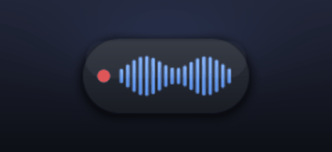
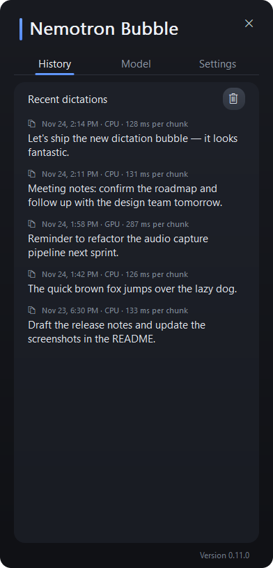
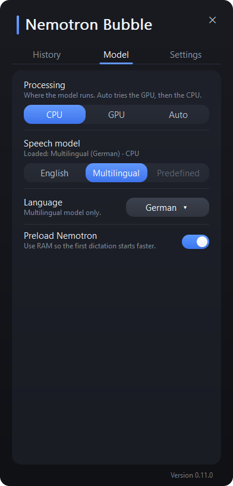
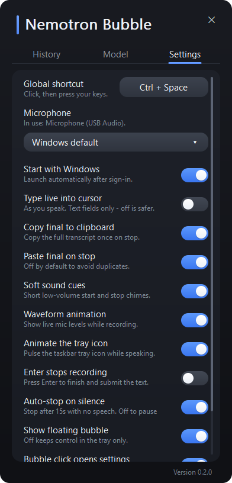

# Nemotron Bubble

**A tiny, beautiful push-to-talk dictation bubble for Windows.**

Press your shortcut, speak, and your words appear at the cursor. Speech recognition runs **on-device** with NVIDIA Nemotron.




___

## What's new in this fork

This is a fork of [snipemanmike/nemotron-bubble](https://github.com/snipemanmike/nemotron-bubble). It keeps the original idea of a tiny, private dictation bubble and builds on it with the following changes:

| Change | Description |
| --- | --- |
| **Redesigned settings window** | A compact window with three tabs (*History*, *Model*, *Settings*) that opens right next to the bubble or the tray icon. Each history entry has a copy icon and shows how fast it was processed. |
| **Multilingual model fixed** | The multilingual Nemotron model crashed while loading and left the app without speech recognition. It now loads reliably and can be selected next to the English model. |
| **Bubble position presets** | Place the floating bubble in one of six positions (top or bottom, each left, center or right). The choice is saved. |
| **Microphone selection** | Choose the input device in the app instead of in the Windows settings. *Windows default* follows a change of the Windows default device without restarting the app. |
| **GPU support** | Run the model on the GPU via DirectML, which works with any DirectX 12 graphics adapter, or stay on the CPU. *Auto* tries the GPU first. |
| **Language selection** | Tell the multilingual model which language you speak instead of letting it guess. 15 languages are offered, and NVIDIA rates this as more accurate than auto-detection. |
| **Clear error feedback** | A missing microphone or a model that fails to load now shows a message instead of the app silently quitting. A log file and `--self-test` help to find the cause. |
| **Portable** | Settings, history and logs are stored next to the exe instead of in `%APPDATA%`. |
| **App icon and version** | The exe has its own icon, and the version is shown in the settings window, the tray menu and the file properties. |

___

## Features

| Feature | Description |
| --- | --- |
| **Push-to-talk** | One shortcut starts and stops dictation from any app. |
| **Customizable shortcut** | Click *Global shortcut* on the *Settings* tab and press any combo (Ctrl / Alt / Shift + key). The default is `Ctrl+Space`. |
| **Safe insertion by default** | On stop the transcript is pasted once (clipboard and a single Ctrl+V), so it never trips app shortcuts. *Type live into cursor* is an opt-in for real text editors. |
| **Auto-stops on silence** | A forgotten recording does not run forever. It stops after 15 s of quiet. |
| **Private and offline** | The Nemotron ONNX model runs locally. No internet, no accounts, no telemetry. |
| **English or multilingual** | Pick the model. For the multilingual one, pick the spoken language or let the model detect it. |
| **CPU or GPU** | Run the model on the processor or on any DirectX 12 graphics adapter. |
| **Live waveform bubble** | A smooth, anti-aliased floating mic meter in one of six preset screen positions. It can also be dragged anywhere. |
| **Tray mode** | Hide the bubble and watch the waveform pulse right in the taskbar tray instead. |
| **Recent dictations** | A scrollable history. The icon next to each entry copies it, and each entry shows how fast it was processed. |
| **One clean clipboard copy on stop** | With optional auto-paste. |
| **Portable** | Settings, history and logs live next to the exe. |
| **Everything toggleable** | Start with Windows, soft sound cues, model preloading and more. |

___

## The settings window

Click the bubble or the tray icon to open it. It appears next to whatever you clicked. Three tabs keep it compact:

<table>
  <tr>
    <th>History</th>
    <th>Model</th>
    <th>Settings</th>
  </tr>
  <tr>
    <td></td>
    <td></td>
    <td></td>
  </tr>
  <tr>
    <td valign="top">Recent dictations, newest first. The icon in front of each entry copies its text. The grey line shows when it was dictated, on which device, and the processing time per audio chunk. The trash bin clears the history.</td>
    <td valign="top">Where the model runs (<b>Processing</b>), which model is loaded (<b>Speech model</b>, with what is loaded right now underneath), the spoken <b>Language</b> for the multilingual model, and <b>Preload Nemotron</b>.</td>
    <td valign="top">The global shortcut, the <b>Microphone</b>, how text is inserted, sounds and animations, the silence auto-stop, and the floating bubble: whether it is shown, what a click on it does, and its <b>Bubble position</b>. The tab scrolls with the mouse wheel.</td>
  </tr>
</table>
> [!NOTE]
>
> The ✕ at the top right hides the window again and the app keeps running in the tray. Speech model, language and processing are also in the tray icon's right-click menu.

___

## Requirements

- **Windows 10 or 11** (64-bit).
- A **microphone**.
- **~2.4 GB free disk** for the speech model (downloaded once).
- **~3 GB of free RAM** while dictating, because the model runs entirely in memory.
- To build from source: the [Rust toolchain](https://rustup.rs) (MSVC).

> [!NOTE]
>
> The Nemotron model has ~0.6B parameters and uses roughly **2.5 to 3 GB of RAM** while loaded. With *Preload Nemotron* enabled (default) that memory is held so the first dictation is instant. Turn it off to keep RAM free when idle. The model then loads on first use instead.
___

## Quick start

```powershell
git clone https://github.com/LittleGitPhoenix/nemotron-bubble.git
cd nemotron-bubble

# One-time: download the Nemotron speech model (~2.4 GB) into models\nemotron\
.\scripts\download-nemotron.ps1

# Build and run
cargo run --release
```

Prefer the multilingual model? Run `.\scripts\download-nemotron.ps1 -Multilingual`. You can also point at a custom folder with `$env:NEMOTRON_MODEL_DIR = "C:\path\to\nemotron"`.

Or grab a prebuilt binary from the [Releases](https://github.com/LittleGitPhoenix/nemotron-bubble/releases) page and run the download script next to it.

### Choosing the model

Pick the model under **Speech model** on the *Model* tab (or in the tray menu):

| Choice | Loads |
| --- | --- |
| **Predefined** | the folder in `NEMOTRON_MODEL_DIR`, otherwise `"model_dir"` from `config\settings.json` |
| **English** | `models\nemotron` |
| **Multilingual** | `models\nemotron_multi`, which detects the spoken language automatically |

`models\` is searched in the working directory, next to the exe and up to four parent folders. On first start the choice is detected: **Predefined** if one of its folders is set, otherwise **English** if installed, otherwise **Multilingual**. Switching unloads the old model first. With *Preload Nemotron* on, the new one loads right away. The line under *Speech model* shows what is loaded, as reported by the model itself.

### Processing (GPU or CPU)

Under **Processing** on the *Model* tab (or in the tray menu) choose where the model runs:

| Choice | Runs on |
| --- | --- |
| **CPU** (default) | the processor |
| **GPU** | DirectML, which works with any DirectX 12 graphics adapter including integrated ones |
| **Auto** | the GPU if possible, otherwise the CPU |

Switching reloads the model. The line under *Speech model* shows the device in use. Each entry in the recent dictations (and in `config\history.json`) records the device and the average processing time per 560 ms audio chunk, so you can compare both on your machine. An integrated GPU is not necessarily faster than the CPU. `--self-test` prints the same measurement.

### Language (multilingual model)

By default the multilingual model works out the spoken language itself. If you know the language, set it under **Language** on the *Model* tab or in the tray menu. NVIDIA's documentation says this is more accurate than auto-detection. The choice applies instantly, without reloading the model. Offered are *Auto-detect* plus the 15 languages NVIDIA rates transcription-ready: Arabic, Dutch, English, French, German, Hindi, Italian, Japanese, Korean, Portuguese, Russian, Spanish, Turkish, Ukrainian, Vietnamese. With the English model selected the setting is greyed out.

### Portable layout

The app keeps all its files next to the exe, so the folder can be copied or deleted as a whole:

```
nemotron-bubble.exe
DirectML.dll
config\    settings.json, history.json, sounds\
log\       nemotron-bubble.log, crash.log
models\    nemotron\, nemotron_multi\
```

The folder must be writable, so don't put it under `C:\Program Files`. The only thing outside it is the *Start with Windows* entry (`HKCU\...\CurrentVersion\Run\NemotronBubble`), which the app removes when you turn that setting off.

___

## Troubleshooting

| Topic | What to do |
| --- | --- |
| **Log file** | `log\nemotron-bubble.log` (next to the exe) records startup, microphone, model loading (folder, file sizes, mode, load time) and every error. The same lines go to `OutputDebugString`, so [DebugView](https://learn.microsoft.com/sysinternals/downloads/debugview) shows them live (filter on `NemotronBubble`). |
| **Self-test** | Run `nemotron-bubble.exe --self-test` from a terminal. It loads the model, runs a few chunks, and prints the device, the processing time per chunk, or the full error. |
| **No microphone** | The app shows a warning and keeps running in the tray. It reopens the microphone the next time you start dictation. |
| **Model fails to load** | A dialog shows the reason. An interrupted download is the usual cause: `encoder.onnx.data` must be about 2.5 GB. Delete the bad file and rerun the script. |

___

## Controls

| Action | How |
| --- | --- |
| Start / stop dictation | your shortcut (default `Ctrl+Space`) |
| Change the shortcut | *Settings* tab → click *Global shortcut*, press the new combo |
| Choose the microphone | *Settings* tab → *Microphone*. *Windows default* follows the Windows sound settings. |
| Open / close the settings window | click the bubble (opens next to it) **or** the tray icon (opens next to the tray) |
| Move the bubble | pick a preset under *Settings* tab → *Bubble position* (saved), or drag it (until the next start) |
| Copy a past dictation | *History* tab → the copy icon in front of the entry |
| Tray menu (start/stop, show/hide bubble, speech model, language, processing, quit) | right-click the tray icon |

___

## How it works

Nemotron Bubble is a Rust app built directly on the Win32 API. There is no Electron and no web view. It ships as one exe with ONNX Runtime linked in, plus `DirectML.dll` for GPU processing. Microphone audio is captured with [`cpal`](https://crates.io/crates/cpal), streamed through the [`parakeet-rs`](https://crates.io/crates/parakeet-rs) Nemotron ONNX model, and injected into the focused window as Unicode keystrokes. The floating bubble is a **per-pixel-alpha layered window** drawn by a small software canvas with signed-distance anti-aliasing, so the pill, shadow, and waveform stay crisp and smooth.

### Source layout

| File | Content |
| --- | --- |
| `src/main.rs` | Startup, `--self-test`, the shared application state |
| `src/settings.rs` | Persisted options, their choice types, loading and saving, file locations |
| `src/history.rs` | Recent dictations and the state of the History list |
| `src/model.rs` | Finding, checking and loading the speech model, GPU probing, languages |
| `src/engine.rs` | The speech engine thread and recording control |
| `src/audio.rs` | Microphone selection, capture and resampling to 16 kHz |
| `src/output.rs` | Clipboard, Ctrl+V and Unicode keystrokes |
| `src/hotkey.rs` | The global shortcut |
| `src/sound.rs` | Start and stop sound cues |
| `src/diagnostics.rs` | Log file, crash logger, message boxes |
| `src/util.rs` | Small Win32 helpers |
| `src/assets.rs` | README art and exe icon export (`assets` feature only) |
| `src/ui/canvas.rs` | Drawing toolkit: canvas, anti-aliased shapes, text, fonts |
| `src/ui/bubble.rs` | The floating bubble: drawing, animation, placement, dragging |
| `src/ui/settings_window/mod.rs` | The settings window frame: header, tab bar, placement, dispatch to the tabs |
| `src/ui/settings_window/history_tab.rs` | The *History* tab |
| `src/ui/settings_window/model_tab.rs` | The *Model* tab |
| `src/ui/settings_window/settings_tab.rs` | The *Settings* tab |
| `src/ui/settings_window/widgets.rs` | Controls shared by the tabs: toggles, buttons, segmented controls, scrollbar |
| `src/ui/tray.rs` | Tray icon and tray menu |
| `src/ui/window.rs` | Window class, message loop, message dispatch |

Every module starts with `use crate::*;`, so all items are available in every file.

___

## Build

```powershell
cargo build --release            # the app

# Regenerate the README art in docs\ (bubble.png, demo.gif and one image per settings tab:
# settings-history.png, settings-model.png, settings-settings.png)
cargo run --release --features assets -- --render-assets docs

# Regenerate the exe icon (embedded by build.rs together with the version info)
cargo run --release --features assets -- --render-icon assets/nemotron-bubble.ico
```

___

## Credits

- Speech recognition via [parakeet-rs](https://crates.io/crates/parakeet-rs) and NVIDIA's Nemotron streaming ASR.
- Model weights hosted on Hugging Face.

___

## License

MIT, see [LICENSE](LICENSE).
